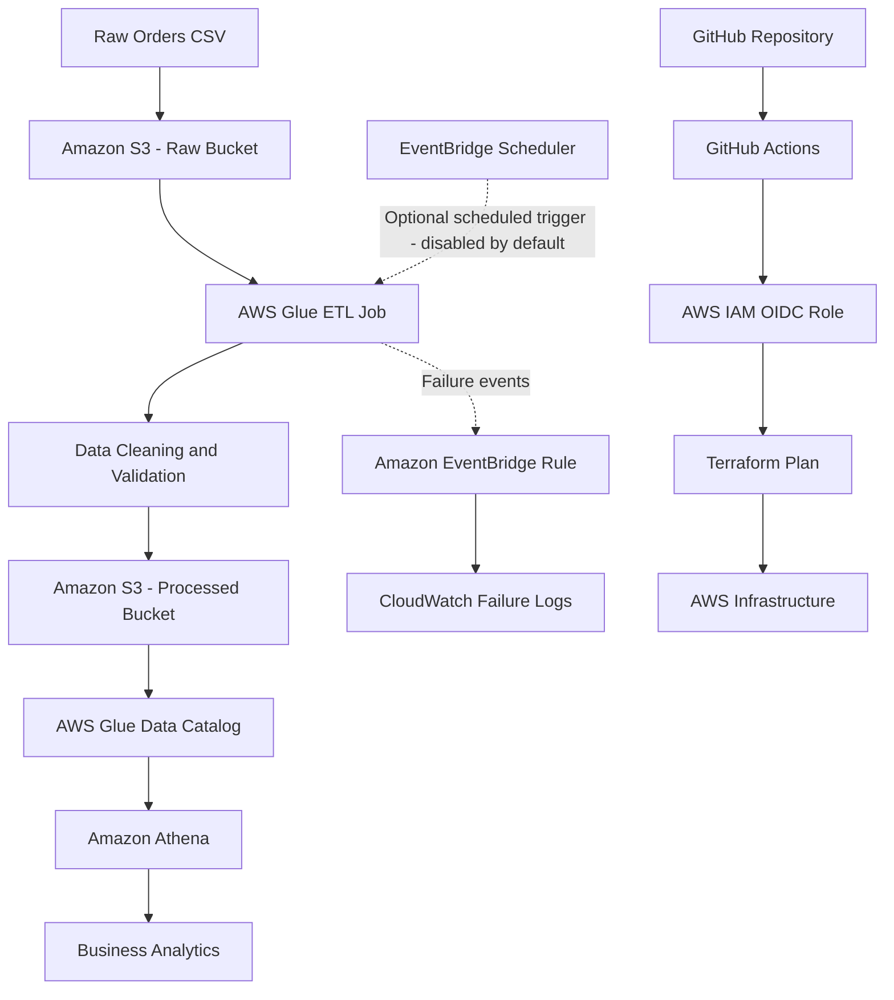

# AWS Data Pipeline — Automated ETL with AWS Glue, S3, Terraform & GitHub Actions

## Project Overview

This project demonstrates an automated, cloud-based data pipeline built on AWS. It processes raw order data, removes duplicate and invalid records, transforms the cleaned data into Parquet format, and stores the results in a separate Amazon S3 bucket for analytics.

The infrastructure is provisioned using Terraform, while GitHub Actions uses AWS IAM OIDC authentication to securely validate infrastructure changes.

## Real-World Problem

Businesses receive order data from multiple applications and systems. Raw datasets can contain duplicate records, missing values, and invalid entries.

Using unprocessed data can lead to inaccurate reports and business decisions.

This project addresses that problem by implementing an ETL workflow:

- **Extract:** Read raw order data from Amazon S3.
- **Transform:** Remove duplicate records, validate data, and filter invalid entries.
- **Load:** Store cleaned data in Parquet format in a separate S3 bucket.
- **Analyze:** Use AWS Glue Data Catalog and Amazon Athena to query processed data.

## Architecture



## Technology Stack

| Technology | Purpose |
|---|---|
| Amazon S3 | Stores raw and processed datasets |
| AWS Glue | Runs the serverless ETL job |
| AWS Glue Data Catalog | Stores database and table metadata |
| Amazon Athena | Queries processed Parquet data using SQL |
| AWS IAM | Controls access between AWS services |
| Amazon EventBridge | Handles Glue failure events and optional scheduling |
| Amazon CloudWatch | Stores Glue logs and failure-event logs |
| Terraform | Provisions and manages AWS infrastructure |
| GitHub Actions | Automates Terraform validation and planning |
| GitHub OIDC | Provides secure GitHub-to-AWS authentication |
| Python / PySpark | Implements ETL transformations |
| Parquet | Stores processed data in a columnar format |

## Data Processing Workflow

1. Upload the source `orders.csv` file to the raw S3 bucket.
2. AWS Glue reads the CSV dataset.
3. The ETL script processes the records.
4. Duplicate order records are removed.
5. Invalid records are rejected.
6. Valid records are transformed into Parquet format.
7. The processed output is written to the processed S3 bucket.
8. AWS Glue Data Catalog provides metadata for the processed dataset.
9. Amazon Athena queries the processed data using SQL.

## ETL Results

The pipeline was tested using a sample dataset containing 20 order records.

| Processing stage | Records |
|---|---:|
| Input records | 20 |
| Records after deduplication | 19 |
| Duplicate records removed | 1 |
| Invalid records rejected | 4 |
| Valid records processed | 15 |

### Sample Analytics Results

Using Amazon Athena:

- Total valid orders: **15**
- Total revenue: **₹220,500**
- Average order value: **₹14,700**

### Revenue by City

| City | Orders | Revenue |
|---|---:|---:|
| Mysore | 4 | ₹115,000 |
| Bangalore | 5 | ₹72,000 |
| Hyderabad | 3 | ₹17,500 |
| Chennai | 3 | ₹16,000 |

## AWS Infrastructure

Terraform provisions and manages the project's AWS resources, including:

- Raw and processed S3 buckets.
- S3 public access blocks and server-side encryption.
- AWS Glue execution IAM role and permissions.
- AWS Glue ETL job.
- Glue Data Catalog database and table.
- EventBridge Scheduler and execution role.
- EventBridge rule for Glue failure events.
- CloudWatch log groups and resource policy.

The Glue job uses AWS Glue 5.0 with G.1X workers and a two-worker configuration.

### Scheduling

An EventBridge Scheduler rule is configured to trigger the Glue job daily using the `Asia/Kolkata` timezone.

**The schedule is disabled by default** to avoid unnecessary recurring Glue execution costs. It can be enabled intentionally when scheduled processing is required.

### Failure Monitoring

An EventBridge rule is configured to capture Glue job state changes for:

- FAILED
- TIMEOUT
- STOPPED

Matching events are routed to a dedicated CloudWatch Logs group.

The failure-event routing configuration is deployed; actual event delivery has not yet been independently tested.

## Terraform Remote State

Terraform state is stored remotely in an Amazon S3 bucket.

The backend configuration uses:

- Remote S3 state storage.
- Server-side encryption.
- S3 bucket versioning.
- S3 public access blocking.
- S3 native state locking using `use_lockfile`.

This helps maintain consistent infrastructure state across local development and GitHub Actions.

## CI/CD with GitHub Actions and OIDC

GitHub Actions automates Terraform infrastructure checks whenever changes are pushed to the `master` branch or a pull request targets it.

### Workflow

1. GitHub Actions starts the workflow.
2. GitHub requests an OIDC identity token.
3. AWS IAM validates the token using a restricted trust policy.
4. GitHub Actions assumes the dedicated IAM role.
5. Terraform formatting is checked.
6. Terraform initializes the backend and providers.
7. Terraform validates the configuration.
8. Terraform generates an infrastructure plan.

### Security Practices

- No long-lived AWS access keys are stored in GitHub Secrets.
- GitHub authenticates through OIDC.
- The IAM trust policy restricts access to the intended repository and branch.
- The GitHub Actions role uses dedicated inline policies rather than broad managed read-only access.
- Terraform state is stored separately from application data.

The workflow validates and plans changes. It does not automatically apply infrastructure changes.

## Repository Structure

```text
AWS-Data-Pipeline/
│
├── .github/
│   └── workflows/
│       └── terraform-ci.yml
│
├── data/
│   └── orders.csv
│
├── scripts/
│   └── etl_job.py
│
├── terraform/
│   ├── main.tf
│   ├── variables.tf
│   └── outputs.tf
│
├── iam/
│   ├── github-oidc-trust.json
│   ├── github-terraform-state-policy.json
│   ├── github-terraform-plan-read-policy.json
│   └── s3-encryption.json
│
├── .gitignore
└── README.md
```

## Deployment Overview

### Prerequisites

- AWS account and configured AWS CLI.
- Terraform installed.
- Git installed.
- Appropriate AWS IAM permissions.

### Terraform Commands

Run these commands from the `terraform` directory:

```bash
terraform init
terraform fmt -check
terraform validate
terraform plan
```

Review the plan before applying any infrastructure changes.

```bash
terraform apply
```

**Important:** Applying Terraform changes can create billable AWS resources. Review the estimated costs and the proposed changes before approval.

## Cost Management

This project was designed with cost control in mind:

- Small sample dataset.
- AWS Glue G.1X workers with a short job timeout.
- Limited Glue concurrency.
- CloudWatch log retention set to three days.
- Daily scheduling disabled by default.
- Infrastructure can be destroyed when no longer required.

The target budget for building, testing, and cleaning up the project was under **US$7**. Actual charges depend on AWS usage and regional pricing.

## Skills Demonstrated

- AWS cloud infrastructure.
- Serverless ETL pipeline design.
- Data cleaning and transformation with Python and PySpark.
- Amazon S3 storage management.
- AWS Glue and Data Catalog.
- SQL analytics with Amazon Athena.
- IAM roles and least-privilege permissions.
- EventBridge event-driven monitoring.
- CloudWatch logging.
- Terraform infrastructure as code.
- Remote Terraform state management.
- GitHub Actions CI/CD.
- GitHub OIDC authentication.

## Project Outcome

Built and tested an AWS-based ETL pipeline that transforms raw order data into analytics-ready Parquet files.

The project demonstrates infrastructure automation, secure CI/CD authentication, data validation, cloud monitoring configuration, and SQL-based analytics using AWS services.

**Author:** Ashish Vittal

**GitHub:** [github.com/AshishVittal](https://github.com/AshishVittal)